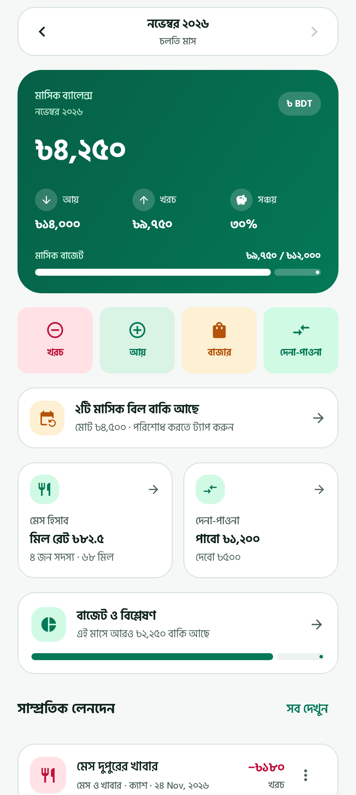
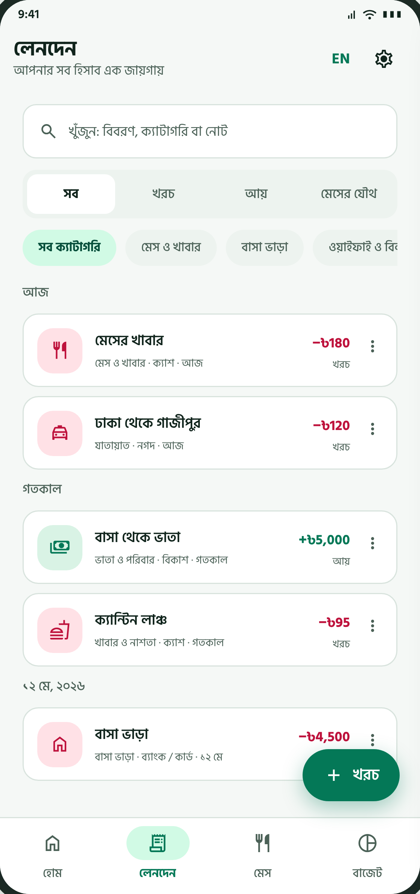
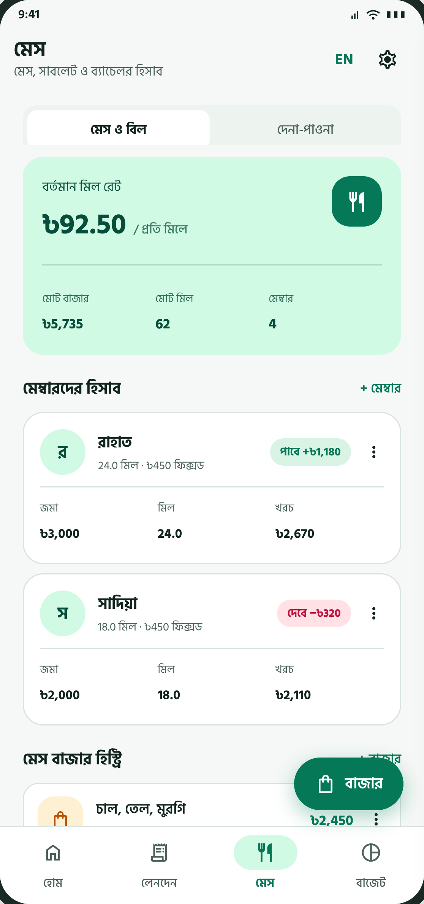
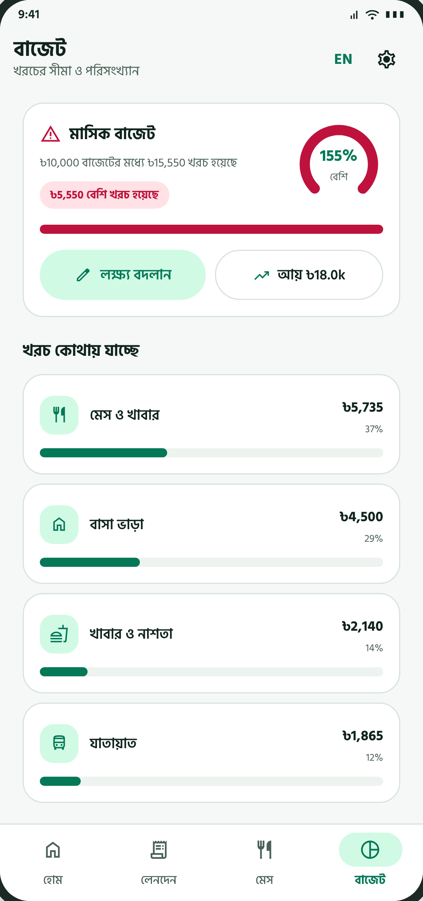

  

<h1 align="center">BachelorHisab (ব্যাচেলর হিসাব)</h1>

  <strong>বাংলাদেশের ব্যাচেলর মেস ও শিক্ষার্থীদের জন্য ১০০% অফলাইন খরচ, মিল, দেনা-পাওনা ও বাজেট ট্র্যাকার।</strong> 
  A bilingual (বাংলা + English), 100% offline personal finance, mess meal, lend/borrow, and monthly budget Android app.

  
  
  
  

  <a href="https://github.com/rcsbxyz-hub/BachelorHisab/releases/latest/download/BachelorHisab-v2.1.0.apk"><strong>⬇️ Download Latest APK (v2.1.0)</strong></a>
  &nbsp;&middot;&nbsp;
  <a href="https://rcsbxyz-hub.github.io/BachelorHisab/"><strong>🌐 Official Website</strong></a>
  &nbsp;&middot;&nbsp;
  <a href="https://rcsbxyz-hub.github.io/BachelorHisab/privacy-policy.html"><strong>🔒 Privacy Policy</strong></a>
  &nbsp;&middot;&nbsp;
  <a href="https://github.com/rcsbxyz-hub/BachelorHisab/releases"><strong>📋 All Releases</strong></a>

---

## ✨ Key Features

- **⚡ Quick Add & Edit:** Amount-first numeric keypad sheet with one-tap categories, payment methods (`Cash`, `bKash`, `Nagad`, `Bank / Card`), full entry editing, and Undo-on-delete.
- **📅 Monthly Scoping:** Track balances, income, expenses, and budget progress per calendar month with an instant month switcher (`< Month Year >`) and all-time transaction history.
- **🍛 Mess & Meal Manager:** Track roommates' deposits, meal counts, shared bazar logs, automatic meal rates, and utility splits.
- **🤝 Lend & Borrow Ledger:** Keep track of receivables and payables between friends with one-tap settle toggles.
- **📊 Budget & Analytics:** Visual 270° budget ring, over-budget alerts, category breakdown bars, and payment-method summaries.
- **🇧🇩 Bilingual & Adaptive Theme:** Instant one-tap switch between **বাংলা** and **English** (rendered cleanly with **Hind Siliguri**), plus **Light**, **Dark**, and **System** themes.
- **💾 Safe Backup & Restore:** Full SQLite snapshot export and staged restore — your financial records never leave your phone.
- **🔔 Automatic Update Alerts:** Checks [`app-update.json`](app-update.json) automatically so you always know when a newer version is ready on the official website.

---

## 📱 App Preview

<table>
  <tr>
    <td align="center"> <b>হোম (Home)</b></td>
    <td align="center"> <b>লেনদেন (Transactions)</b></td>
    <td align="center"> <b>মেস ও দেনা-পাওনা (Mess)</b></td>
    <td align="center"> <b>বাজেট (Budget)</b></td>
  </tr>
</table>

---

## 🔒 Privacy & Security

- **100% offline:** Zero cloud accounts, zero ads, zero tracking.
- **On-device storage:** All financial entries stay locally on your Android device.
- Read the full bilingual privacy policy here: **[Privacy Policy](https://rcsbxyz-hub.github.io/BachelorHisab/privacy-policy.html)**.

---

<strong>🛠️ Maintainer Release Workflow (Click to expand)</strong>

This public repository hosts only the official static website, `app-update.json`, privacy policy, and signed APK releases (application source code is maintained privately).

To publish a new version (e.g. `v1.2.0` / `versionCode = 3`):
1. Build and sign `BachelorHisab-v1.2.0.apk` with the release keystore.
2. Add `releases/BachelorHisab-v1.2.0.apk` and update `app-update.json` (`latestVersionCode`, `latestVersionName`, `apkUrl`, `notes`) on `main`.
3. Push `main` and push tag `v1.2.0`:
   - **GitHub Actions (`sync-pages.yml`)** automatically updates `https://rcsbxyz-hub.github.io/BachelorHisab/`.
   - **GitHub Actions (`publish-release.yml`)** automatically publishes the GitHub Release and attaches the signed APK.
   - Installed apps automatically notify users and direct them to the official website download section.

---

  © 2026 <strong>Rudro Chandro Sarker (RCS)</strong> · All Rights Reserved (<a href="LICENSE">License</a>) · <a href="mailto:rcsbxyz@gmail.com">rcsbxyz@gmail.com</a>

